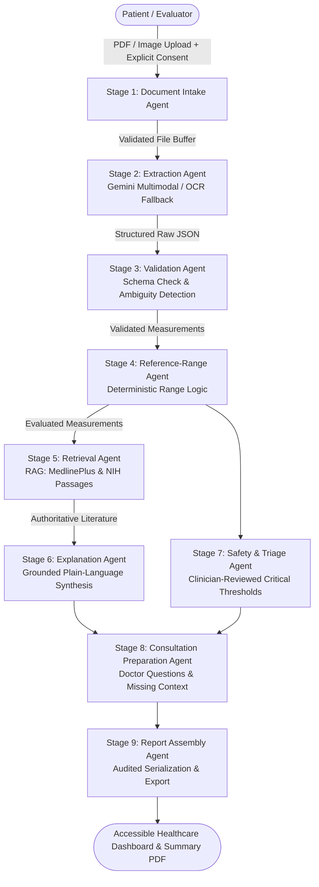

# MediLens AI — Intelligent Medical Report Understanding Assistant

> **"Understand your medical reports. Prepare for better conversations."**

**MediLens AI** is an intelligent, accessible, safety-first web application designed to help patients understand complex laboratory reports. Powered by Google Gemini models, a traceable 9-stage agentic AI workflow, Retrieval-Augmented Generation (RAG) grounded in authoritative medical literature (MedlinePlus / NIH), and Firebase, MediLens AI bridges the gap between laboratory results and meaningful doctor-patient conversations without diagnosing diseases or prescribing treatments.

---

## Architecture Overview



---

## Key Features

1. **Multimodal Document Understanding**: Accepts digital lab PDFs, scanned pages, and high-resolution mobile photos (PDF, JPG, PNG). Handles multi-analyte tables, decimal places, inequality operators (`<`, `>`, `≤`, `≥`), and laboratory-printed flags (`H`, `L`, `CRITICAL`).
2. **Deterministic Range Evaluation**: Evaluates values against laboratory-printed reference ranges using deterministic code (standard intervals, open-ended intervals like `< 200` or `> 40`, boundary values, qualitative results). Never hallucinates intervals.
3. **Grounded RAG (No Citation Hallucination)**: Uses curated medical literature from MedlinePlus (U.S. National Library of Medicine) and NIH. Every explanation displays clickable source citations with exact supporting literature passages.
4. **Clinical Safety & Conservative Triage**: Versioned clinician-reviewed critical value rules (`v1.2-consensus-2024`) detect life-threatening anomalies (severe hyperkalemia, severe hypoglycemia, elevated troponin, critical thrombocytopenia) with emergency escalation advice. Strictly enforces baseline non-reassurance.
5. **Historical Report Trend Comparison**: Matches biomarkers across dates with verified unit conversion factors (e.g., Glucose: $\text{mmol/L} \leftrightarrow \text{mg/dL}$; Cholesterol: $\text{mmol/L} \leftrightarrow \text{mg/dL}$; Hemoglobin: $\text{g/L} \leftrightarrow \text{g/dL}$). Flags incompatible tests and provides neutral clinical trend descriptions.
6. **Doctor Consultation Preparation**: Synthesizes relevant questions to ask during a medical visit, identifies missing clinical context (fasting status, medications, age, symptoms), and offers a printable summary.
7. **Human-in-the-Loop OCR Verification**: Flags low-confidence scan smudges or ambiguities for explicit user verification before analysis.
8. **User Privacy & Isolation**: Multi-tenant isolation by user ID, server-side token authentication, and one-click permanent data deletion.
9. **Zero-Friction Evaluator Demo Mode**: 7 pre-configured synthetic demo scenarios (CBC, CMP, Historical trend, Missing range, Ambiguous OCR, Critical alert) that run immediately without uploading real documents or entering credit cards.

---

## Technology Stack

- **Frontend**: React 18, TypeScript, Vite, Tailwind CSS, Lucide Icons.
- **Backend**: Node.js 20, TypeScript, Express, Zod (typed validation).
- **AI Models & SDK**: Google Gemini models (`gemini-1.5-flash` / `gemini-2.0-flash`, `text-embedding-004`) via the official `@google/generative-ai` SDK.
- **RAG & Vector Retrieval**: Modular vector store supporting Google embeddings with lexical BM25 fallback.
- **Authentication & Security**: Firebase Authentication, Cloud Firestore rules, private storage isolation.
- **Deployment**: Google Cloud Run (containerized backend) and Firebase Hosting.

---

## Project Structure

```
medilens-ai/
├── backend/
│   ├── src/
│   │   ├── agents/          # 9 logical agents (Intake, Extraction, Validation, Range, RAG, Explanation, Safety, Consultation, Assembly)
│   │   ├── rag/             # Curated MedlinePlus/NIH knowledge base & vector store
│   │   ├── safety/          # Clinician-reviewed critical rules & mandatory disclaimers
│   │   ├── comparison/      # Historical matching & verified unit conversions
│   │   ├── auth/            # Firebase token verification & demo user isolation
│   │   ├── storage/         # Local & Firestore storage layers
│   │   ├── demo/            # 7 synthetic demo reports
│   │   ├── routes/          # REST API endpoints (/reports, /demo, /health)
│   │   ├── schemas/         # Strict Zod schemas
│   │   ├── services/        # Gemini multimodal document & explanation service
│   │   └── server.ts        # Express entry point
│   ├── tests/               # Automated Jest test suites
│   ├── Dockerfile           # Multi-stage production container
│   └── package.json
├── frontend/
│   ├── src/
│   │   ├── components/      # Accessible healthcare UI components (Table, ExplanationCard, SafetyBanner, DemoSelector)
│   │   ├── pages/           # Landing, Dashboard, Upload, AnalysisDetail, Comparison, Privacy
│   │   ├── services/        # Frontend API client
│   │   ├── context/         # AuthContext
│   │   ├── types/           # Shared TypeScript interfaces
│   │   ├── App.tsx
│   │   └── main.tsx
│   ├── vite.config.ts
│   └── tailwind.config.js
├── docs/
│   ├── ARCHITECTURE.md      # Detailed 9-stage design, RAG, and safety rules
│   ├── API_DOCUMENTATION.md # REST API endpoint specifications
│   ├── DEMO_WALKTHROUGH.md  # Step-by-step evaluator testing guide
│   └── DEPLOYMENT_GOOGLE_CLOUD.md # Cloud Run & Firebase deployment instructions
├── firebase/
│   ├── firestore.rules      # Least-privilege Firestore rules
│   ├── storage.rules        # Private bucket storage rules
│   └── firebase.json
└── README.md
```

---

## Quickstart Guide

### 1. Prerequisites
- Node.js v18+ (tested on Node v20.12.2)
- npm v10+

### 2. Install & Run Backend
```bash
cd backend
npm install
npm run dev
```
The backend starts at `http://localhost:5000`. Health check is available at `http://localhost:5000/health`.

### 3. Install & Run Frontend
```bash
cd frontend
npm install
npm run dev
```
Open `http://localhost:3000` in your web browser.

### 4. Running Automated Tests
```bash
cd backend
npm test
```

**Test Results**:
```text
PASS tests/referenceRange.test.ts
PASS tests/safetyRules.test.ts
PASS tests/unitConversion.test.ts
PASS tests/historicalComparison.test.ts
PASS tests/ragAndValidation.test.ts
PASS tests/apiRoutes.test.ts

Test Suites: 6 passed, 6 total
Tests:       28 passed, 28 total
Snapshots:   0 total
Time:        7.17 s
Ran all test suites.
```

---

## Mandatory Healthcare Safety Disclaimer

> **MediLens AI provides educational information to help you understand medical reports. It does not diagnose conditions, replace a qualified healthcare professional, or recommend treatment. Laboratory reference ranges and results must be interpreted in clinical context. Contact your healthcare professional for advice about your results.**

---

## License

This project is released under the MIT License for educational and demonstration purposes.
