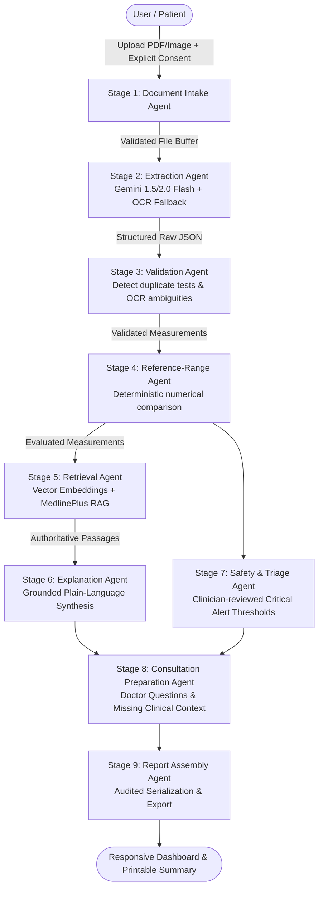

# MediLens AI — Architecture & Technical Design

## 1. System Overview

MediLens AI is an intelligent healthcare communication assistant designed to help patients understand complex laboratory reports. It bridges the gap between laboratory test data and patient comprehension by combining **Google Gemini multimodal document understanding**, a **9-stage traceable agentic workflow**, **retrieval-augmented generation (RAG)** grounded in authoritative medical literature (MedlinePlus/NIH), and **clinician-reviewed deterministic safety rules**.

---

## 2. Nine Specialized Agentic Workflow Stages

The workflow avoids unconstrained LLM loops and maintains an explicit, traceable pipeline where numerical evaluations and safety thresholds are executed by deterministic code:

### Stage 1: Document Intake Agent (`intakeAgent.ts`)
- Enforces strict file validation (allowed MIME types: PDF, JPG, PNG; max size: 15MB).
- Verifies explicit user consent before processing sensitive medical records.
- Detects whether the input is a digital PDF, scanned image, or mixed document.
- Assigns a cryptographically unique processing identifier (`reportId`).

### Stage 2: Extraction Agent (`extractionAgent.ts` & `geminiService.ts`)
- Utilizes Google Gemini's multimodal capabilities (`gemini-1.5-flash`) to parse multi-column tables, headers, and laboratory footnotes.
- Preserves raw values, units, laboratory-specific reference intervals, and printed abnormal flags (e.g. `H`, `L`, `CRITICAL`).
- Never fabricates missing ranges or patient demographics; represents missing values as `null` or `"Not provided"`.
- Records extraction confidence and source snippets for auditability.

### Stage 3: Validation Agent (`validationAgent.ts`)
- Performs strict schema validation with Zod.
- Detects inverted laboratory intervals (minimum > maximum).
- Flags biologically implausible outliers and duplicate test rows with conflicting values.
- Flags low-confidence OCR artifacts (e.g., confidence < 75% or blurred scan lines) for explicit human confirmation.

### Stage 4: Reference-Range Evaluation Agent (`referenceRangeAgent.ts`)
- Employs deterministic application code for numerical comparisons:
  - Standard two-sided intervals: $[low, high]$
  - Open-ended intervals: $< 200$, $\le 100$, $> 40$, $\ge 60$
  - Boundary value handling: values on boundary are marked within range.
  - Qualitative results: matches `"Negative"`, `"Non-reactive"`, etc.
  - Missing intervals: safely marked as `indeterminate`.

### Stage 5: Medical Knowledge Retrieval Agent (`retrievalAgent.ts` & `vectorStore.ts`)
- Retrieves curated, authoritative clinical articles from MedlinePlus (U.S. National Library of Medicine) and NIH.
- Modular retrieval layer: uses `text-embedding-004` when Google GenAI credentials are configured, with BM25/keyword similarity fallback for local evaluation.
- Attaches provenance metadata: title, publisher, URL, review date, and exact passage text.

### Stage 6: Explanation Agent (`explanationAgent.ts`)
- Generates plain-language educational summaries grounded strictly in retrieved medical literature.
- Explains what each biomarker measures and common reasons for variation.
- Never diagnoses diseases, recommends medications, or suggests dosage alterations.
- Explicitly separates extracted laboratory facts from educational interpretations.

### Stage 7: Safety & Triage Agent (`safetyAgent.ts` & `criticalRules.ts`)
- Implements versioned clinician-reviewed escalation rules (`v1.2-consensus-2024`).
- Evaluates life-threatening thresholds (severe hyperkalemia, profound hypoglycemia, elevated troponin, critical thrombocytopenia).
- Preserves laboratory-printed critical alert flags.
- Enforces baseline non-reassurance: clearly explains that values within reference range do not automatically rule out underlying illness.

### Stage 8: Consultation Preparation Agent (`consultationAgent.ts`)
- Synthesizes personalized, relevant questions for the patient's doctor visit based on out-of-range results.
- Highlights missing clinical context (fasting status, medications, age, biological sex, symptoms).
- Creates a concise, factual summary suitable for printing or saving.

### Stage 9: Report Assembly Agent (`assemblyAgent.ts`)
- Combines validated measurements, deterministic range evaluations, grounded explanations, safety alerts, and consultation questions into a typed `ReportAnalysis` record.
- Separates audit metadata (latency, stage tracking, model version) from patient-facing explanations.

---

## 3. Historical Longitudinal Report Comparison

Longitudinal tracking between reports (`historicalMatcher.ts` & `unitConverter.ts`) adheres to strict clinical safety principles:
- Matches tests across dates using standardized LOINC codes and alias groups.
- Applies verified conversion functions only when clinically valid (e.g., Glucose: $\text{mmol/L} \leftrightarrow \text{mg/dL}$, factor 18.0182; Cholesterol: $\text{mmol/L} \leftrightarrow \text{mg/dL}$, factor 38.67; Hemoglobin: $\text{g/L} \leftrightarrow \text{g/dL}$, factor 10).
- Flags incompatible units (e.g. percentage vs absolute count) rather than inventing a comparison.
- Generates neutral trend descriptions (e.g., "Numerical decrease of 15 mg/dL") without claiming clinical improvement or disease cure.

---

## 4. Privacy, Security & Isolation Architecture

- **Least-Privilege Authorization**: Server-side verification of authentication tokens ensures users can only access their own reports.
- **Data Deletion Guarantee**: Cascade deletion permanently purges metadata, extracted records, and files.
- **Safe Logging**: Report identifiers are logged without logging raw patient health information (PHI).
- **Client Security**: API keys and secrets are never bundled into client-side code; all GenAI and Firestore operations execute within the secure backend container.
